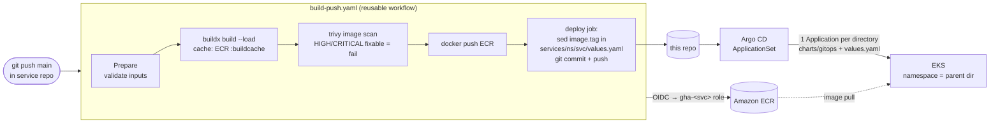

# devops-gitops

The **GitOps repo** behind a set of microservices on **AWS EKS**: one shared Helm chart, one
reusable GitHub Actions pipeline (build → scan → push → bump tag), shared Dockerfiles per
language, and **Argo CD ApplicationSets** that turn a directory into a deployed service.

Argo CD only reads this repo. Service repos contain code and a 15-line `ci.yaml`, nothing else.
The EKS cluster, IAM/IRSA and addons come from [aws-eks-terraform-gitops](https://github.com/bomtan2000/aws-eks-terraform-gitops).

## How a commit reaches the cluster



| Trigger in the service repo | Image tag | Values file updated | Deployed by |
|---|---|---|---|
| push to `main` | first 8 chars of the commit SHA | `values.yaml` | `argocd/services.yaml` in the **dev** cluster |
| git tag `release-vX.Y.Z` (must match `<name>-vX.Y.Z`) | the git tag | `values-qc.yaml` | `argocd/qc.yaml` in the **QC** cluster |

Rollback = `git revert` the `deploy(<service>): <tag>` commit in this repo. Argo CD syncs the old tag back.

## Layout

```
.github/workflows/build-push.yaml      reusable CI: validate, build, scan, push, bump tag
.github/workflows/security-scan.yaml   reusable CI: SonarQube quality gate (node / java)
.github/actions/trivy-image/           composite action: pinned trivy binary, sha256-verified
docker/node/Dockerfile                 shared Dockerfile for Node.js services
docker/java/Dockerfile                 shared Dockerfile for Java (Gradle) services
docker/*/Dockerfile.dockerignore       per-Dockerfile ignore list (BuildKit picks it up)
charts/gitops/                         shared Helm chart: Deployment or Job, Service, SA, Ingress, HPA
services/<namespace>/<service>/        values.yaml (dev) and values-qc.yaml (QC) per service
argocd/services.yaml                   ApplicationSet for dev: one Application per services/*/* directory
argocd/qc.yaml                         ApplicationSet for QC: one Application per values-qc.yaml file
```

## Day-to-day

| Task | How |
|---|---|
| Deploy a new version | Push to the service repo. CI builds and writes the tag here. Argo CD deploys. |
| Change config (port, replicas, paths) | Edit that service's `values.yaml`, push. |
| Change it for every service | Edit `charts/gitops/values.yaml` (defaults) or `charts/gitops/templates/`. |
| Add a service or a namespace | Create `services/<namespace>/<service>/values.yaml`, push. The Application shows up within ~3 min (git generator poll). Argo CD creates the namespace. |
| Move a service to another namespace | Move the directory, push. Argo CD prunes the old one and creates the new one. |
| Enable QC for a service | Create `values-qc.yaml` next to `values.yaml`. |
| Release to QC | `git tag release-v1.2.3 && git push --tags` in the service repo. |

Argo CD creates namespaces, **not** Secrets. `<service>-secret` is created by hand in the right namespace.

### A service's values.yaml

Defaults (1 replica, port 3000, `/health` probes, shared ALB, 15 s preStop) live in the chart.
A service only writes what is specific to it:

```yaml
nameOverride: payment-service        # = directory name, otherwise resources are named payment-service-gitops

image:
  repository: 111122223333.dkr.ecr.ap-southeast-1.amazonaws.com/apps/payment-service
  tag: ""                            # written by CI; keep the 2-space indent (CI uses sed)

serviceAccount:
  name: payment-service-sa           # must match the IAM role trust policy (IRSA)
  annotations:                       # drop if the service never calls the AWS SDK
    eks.amazonaws.com/role-arn: arn:aws:iam::111122223333:role/eks-payment-service-role

envFrom:
  - secretRef:
      name: payment-service-secret

ingress:                             # drop if the service needs no route on the ALB
  hosts:
    - paths:
        - path: /payments
          pathType: Prefix
```

Preview exactly what Argo CD will apply:

```bash
helm template order-service charts/gitops -n app -f services/app/order-service/values.yaml --skip-tests
```

## Service repo setup

`.github/workflows/ci.yaml` in the service repo is all it needs:

```yaml
name: build-push

on:
  push:
    branches: [main]
    tags: ['release-v*']
    paths-ignore: ['**.md']
  workflow_dispatch:

jobs:
  build-push:
    uses: bomtan2000/devops-gitops/.github/workflows/build-push.yaml@main
    permissions:
      contents: read
      id-token: write
    with:
      aws-role-arn: ${{ vars.AWS_ROLE_ARN }}
      template: node            # or java, or dockerfile: Dockerfile for a custom one
      scan-image: true          # false = skip the trivy scan (build -> push directly)
    secrets:
      DEVOPS_TOKEN: ${{ secrets.DEVOPS_TOKEN }}
```

Inputs of `build-push.yaml` (passed under `with:`; a reusable workflow does not read the caller's `env`):

| Input | Type | Default | Meaning |
|---|---|---|---|
| `aws-role-arn` | string | required | IAM role assumed through GitHub OIDC (`gha-<service>`) |
| `template` | string | `node` | Shared Dockerfile `docker/<template>/Dockerfile` (`node`, `java`) |
| `dockerfile` | string | `""` | Dockerfile inside the service repo. When set, `template` is ignored |
| `scan-image` | boolean | `true` | trivy scan between build and push. `false` skips it |

Prefer ignoring **one** CVE over turning the scan off: add its ID to `.trivyignore` at the root
of the service repo, one ID per line with the reason in a comment. `scan-image: false` is for an
emergency hotfix, and should be reverted in the next commit.

| Name | Kind | Value |
|---|---|---|
| `AWS_ROLE_ARN` | Variable | `arn:aws:iam::<account>:role/gha-<service>`. Trust policy allows `refs/heads/main` and `refs/tags/release-v*` of that repo only. |
| `DEVOPS_TOKEN` | Secret | Fine-grained token: this repo only, `Contents: Read and write` |

| Template | For | Service repo must contain |
|---|---|---|
| `node` (default) | Node.js | `package.json`, `package-lock.json`, `server.js` |
| `java` | Java + Gradle (Spring Boot) | `settings.gradle`, `build.gradle`, `gradle.properties`, `src/`, `libs/`, `fonts/`. Build produces one `*-SNAPSHOT.jar` |

A custom Dockerfile (`dockerfile: Dockerfile`) needs a `.dockerignore` in the service repo with a
`devops` line, so the checked-out GitOps repo is not copied into the image.

Java services start slower and need more memory than the defaults (128Mi, 10 s). Without this
they get `OOMKilled` or killed by the liveness probe in a loop:

```yaml
livenessProbe:  { httpGet: { path: /actuator/health }, initialDelaySeconds: 60 }
readinessProbe: { httpGet: { path: /actuator/health }, initialDelaySeconds: 60 }
ingress:
  annotations:
    alb.ingress.kubernetes.io/healthcheck-path: /actuator/health
resources:
  requests: { cpu: 250m, memory: 512Mi }
  limits:   { cpu: "1",  memory: 768Mi }
```

Build locally from a service repo, the same way CI does:

```bash
git clone https://github.com/bomtan2000/devops-gitops.git devops
docker build -f devops/docker/node/Dockerfile -t order-service:local .
docker run --rm -p 3000:3000 order-service:local
rm -rf devops
```

## Design decisions

| Decision | Why |
|---|---|
| Separate GitOps repo, CI writes the tag here | The cluster state is one `git log`. Rollback is `git revert`. CI never needs cluster credentials. |
| ApplicationSet **git generator** on directories | Adding a service is "create a folder". Namespace comes from the parent directory. No Argo CD YAML per service. |
| Dev and QC: same chart, `values-qc.yaml` layered on top, QC only from git tags | QC runs exactly the artifact that will be released. QC differs from dev only where it must (tag, IRSA role). |
| One shared Helm chart | Probes, preStop, resources, ingress conventions are fixed in one place. A fix lands in every service on its next sync. |
| One **reusable workflow** | 15-line `ci.yaml` per service. Changing the pipeline is one PR here, not N PRs. |
| GitHub OIDC → IAM role per service | No AWS keys stored in GitHub. Each role can only be assumed from `main` or `release-v*` tags of its own service repo. The shared push policy is limited to the services' ECR repos. |
| Build → **scan** → push (`--load`, then trivy, then `docker push`) | A vulnerable image never reaches the registry, so the cluster cannot pull one. |
| trivy as a pinned binary + sha256, not `trivy-action` | Supply chain: a moved tag on a third-party action cannot change what runs. Every action is pinned by commit SHA too. |
| `--ignore-unfixed`, HIGH/CRITICAL only | Blocks what a rebuild/upgrade can actually fix. Unfixable CVEs would block every build forever. |
| buildx registry cache in ECR (`:buildcache`) | Unchanged `package-lock.json` skips `npm ci`. Cache sits next to the image, no extra storage. |
| Release tags are **immutable** | CI refuses to build `release-vX.Y.Z` if that tag already exists on ECR. A version always means one image. |
| Separate `build` and `deploy` jobs | Only the build job gets AWS credentials. Only the deploy job uses the GitOps write token. |
| Concurrency groups + `pull --rebase` retry (3x) on push | Several services finishing at once all commit to this repo. No lost updates, no failed pipelines on a race. |
| ARM runners (`ubuntu-24.04-arm`) | Images are built natively for arm64 (Graviton nodes): cheaper nodes, no QEMU emulation. Nodes must be arm64. |
| One shared ALB (`group.name: app`), path-based routing | One load balancer for every service instead of one per Ingress. |
| `preStop: sleep 15` | The ALB keeps sending traffic until the pod is deregistered from the target group. Without the sleep, deploys cause 502s. |
| `automountServiceAccountToken: false` by default | Pods do not get a Kubernetes API token unless they need one. IRSA uses its own projected token. |
| Secrets created by hand, referenced via `envFrom` | No secret ever lands in Git. External Secrets is the next step. |

## Troubleshooting

| Symptom | Cause | Fix |
|---|---|---|
| CI: `Not authorized to perform sts:AssumeRoleWithWebIdentity` on a release tag | The role trust policy only allows `...:ref:refs/heads/main` | Add `...:ref:refs/tags/release-v*` with `StringLike` |
| Pod `ImagePullBackOff`, image tag `1.16.0` | `image.tag` is empty, so the chart falls back to `appVersion` | Never leave `tag: ""` in a deployed values file |
| QC pod: `InvalidIdentityToken` / `AccessDenied` from AWS | `values-qc.yaml` has no QC role, so the pod uses the dev role, which only trusts the dev cluster's OIDC | Set `serviceAccount.annotations` in `values-qc.yaml`. Check: `kubectl exec ... -- printenv AWS_ROLE_ARN` |
| Java pod restarts in a loop / `OOMKilled` | Default 128Mi limit and 10 s probe delay | Use the Java values above |
| 502 from the ALB during deploys | Pod stopped before target deregistration | Keep `preStop` ≥ ALB deregistration delay |
| Resources named `<svc>-gitops` | `nameOverride` missing | Set `nameOverride` = directory name |
| CI: `Push to the GitOps repo failed after 3 attempts` | Heavy contention or the token lost write access | Re-run the job. Check `DEVOPS_TOKEN` expiry |
| New service directory, no Application after 5 min | ApplicationSet not applied to this cluster, or YAML error | `kubectl -n argocd get applicationset`, `kubectl -n argocd describe applicationset services` |
| CI: `Need exactly 1 devops/services/<namespace>/<svc>/values.yaml` | Service name duplicated in two namespaces, or the folder is missing | Service names are unique across the repo |

## Next steps

- External Secrets Operator (AWS Secrets Manager) instead of hand-made `<service>-secret`.
- Argo CD Image Updater or a PR-based promotion to QC, instead of a direct commit.
- Webhook from GitHub to Argo CD so new services appear in seconds instead of after the poll.
- Sign images (cosign) and verify on admission (Kyverno).
- `environment: qc` with required reviewers is already stubbed in `build-push.yaml`.

## License

[MIT](LICENSE)
